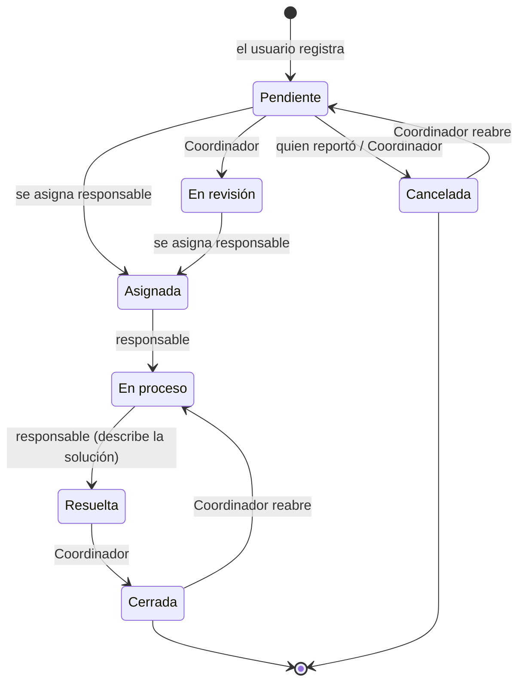

# Arquitectura y seguridad

## 1. Tecnologías

| Capa | Tecnología |
|---|---|
| Servidor | Apache (XAMPP) |
| Lenguaje | PHP 8 (sin frameworks), acceso a datos con el **driver oficial de MongoDB** (`MongoDB\Client`) |
| Base de datos | **MongoDB** (documentos); librería `mongodb/mongodb` incluida en `vendor/` |
| Interfaz | HTML5, CSS propio (sin frameworks), JavaScript sin librerías |
| PDF | FPDF 1.9 (incluida en `app/lib/fpdf`) |
| Correo (opcional) | Cliente SMTP propio con STARTTLS/SSL (`app/helpers/correo.php`) |

## 2. Estructura del proyecto

```
sistema-incidencias/
├── app/
│   ├── config/        database.php · institucion.php · correo.php
│   ├── controllers/   AuthController.php (inicio de sesión)
│   ├── helpers/       seguridad · auth · evidencias · correo · paginacion · carreras · ticket_pdf
│   ├── lib/fpdf/      Librería para generar PDF
│   ├── models/        Usuario · Incidencia · Notificacion · Reporte ·
│   │                  Catalogo · Evidencia · Restablecimiento · IntentoLogin
│   └── views/         layouts (encabezado y pie) · auth (login y recuperación)
├── database/
│   └── seed_mongo.php Crea colecciones, índices, contadores y datos iniciales
├── vendor/            Librería mongodb/mongodb incluida (no requiere Composer)
├── docs/              Esta documentación
├── public/            Páginas que abre el navegador (única carpeta pública)
│   ├── css/ · js/ · img/
│   └── *.php
└── storage/
    └── evidencias/    Archivos subidos (sin acceso directo)
```

### Organización del código

Cada página de `public/` sigue el mismo esquema:

1. Carga `app/helpers/auth.php` y verifica sesión y rol (`requerirSesion()` / `requerirRol()`).
2. Si es un envío de formulario (POST): valida el token CSRF y los datos, llama al **modelo**, guarda un mensaje
   *flash* y **redirige** (patrón Post/Redirect/Get, para que recargar la página no repita la acción).
3. Consulta los datos con los **modelos** y dibuja la vista con el encabezado y pie comunes.

Los **modelos** (`app/models/`) concentran las consultas a MongoDB y las reglas de negocio: por ejemplo,
`Incidencia::cambiarEstado()` actualiza el estado, maneja la fecha de cierre, escribe el historial (embebido en
el documento de la incidencia) y prepara las notificaciones. Como el historial, los comentarios y las evidencias
se guardan dentro del mismo documento, cada cambio es una escritura atómica y no hacen falta transacciones entre
varias tablas.

## 3. Módulos

| Módulo | Páginas | Modelo / helper |
|---|---|---|
| Autenticación | `login.php`, `logout.php`, `recuperar.php`, `restablecer.php` | `AuthController`, `Restablecimiento`, `correo.php` |
| Incidencias | `incidencias.php`, `mis_incidencias.php`, `detalle_incidencia.php`, `asignadas.php`, `todas_incidencias.php` | `Incidencia` |
| Evidencias | `evidencia.php` (descarga protegida) | `Evidencia`, `evidencias.php` |
| Ticket | `ticket.php` | `ticket_pdf.php` (FPDF) |
| Notificaciones | `notificaciones.php`, `notificaciones_contador.php` (JSON) | `Notificacion` |
| Reportes | `reportes.php`, `reportes_exportar.php` (CSV) | `Reporte` |
| Usuarios | `usuarios.php`, `usuario_form.php`, `perfil.php` | `Usuario` |
| Catálogos | `catalogos.php` | `Catalogo` |

## 4. Flujo de estados



- Al pasar a **Resuelta**, **Cerrada** o **Cancelada** se guarda la `fecha_cierre` (solo la primera vez).
  Si se reabre, se limpia.
- El Coordinador y el Administrador pueden elegir cualquier estado; el responsable solo *En proceso* y *Resuelta*.
- Cada cambio queda en `historial_incidencias` y genera notificaciones.

## 5. Permisos por rol

| Acción | Administrador | Coordinador | Docente / Administrativo | Estudiante |
|---|:-:|:-:|:-:|:-:|
| Registrar incidencias y ver las propias | ✔ | ✔ | ✔ | ✔ |
| Comentar, adjuntar evidencias, descargar ticket | ✔ | ✔ | ✔ (propias y asignadas) | ✔ (propias) |
| Cancelar la propia incidencia *Pendiente* | ✔ | ✔ | ✔ | ✔ |
| Atender incidencias asignadas | ✔ | ✔ | ✔ | — |
| Ver todas las incidencias, asignar, cambiar estado, reclasificar | ✔ | ✔ | — | — |
| Reportes y exportación | ✔ | ✔ | — | — |
| Usuarios, catálogos, restablecer contraseñas | ✔ | — | — | — |

Los permisos se validan **en el servidor** en cada página y en cada acción; ocultar un botón no es la única protección.

## 6. Medidas de seguridad

| Riesgo | Medida |
|---|---|
| Inyección (NoSQL) | Las consultas a MongoDB se arman con arreglos tipados (el driver envía los valores como datos BSON, no como texto que se concatena). `app/helpers/seguridad.php` descarta de `$_GET`, `$_POST` y `$_COOKIE` todo valor que no sea texto, así que un `correo[$ne]=x` nunca llega a un filtro como operador; además, los modelos convierten los valores a su tipo (entero, texto) y los nombres de colección dinámicos se validan contra una lista permitida. Las búsquedas por texto usan `MongoDB\BSON\Regex` con el término escapado (`preg_quote`). |
| XSS (código en textos) | Todo dato mostrado pasa por `e()` (`htmlspecialchars`). Además, la cabecera `Content-Security-Policy` solo permite scripts del propio sitio (sin scripts en línea). |
| CSRF (formularios falsos desde otro sitio) | Cada formulario lleva un token aleatorio por sesión que se verifica con `hash_equals`, incluidos el **inicio** y el **cierre de sesión** (este último solo por POST). La cookie de sesión es `SameSite=Lax`. |
| Clickjacking | `X-Frame-Options: DENY` y `frame-ancestors 'none'`: el sistema no puede mostrarse dentro de otra página. |
| Cabeceras HTTP | `Content-Security-Policy`, `X-Content-Type-Options: nosniff`, `Referrer-Policy`, `Permissions-Policy`, `Cross-Origin-Opener-Policy` y `Cross-Origin-Resource-Policy` en todas las páginas; `Strict-Transport-Security` (HSTS) cuando se usa HTTPS. Se quita `X-Powered-By`. |
| Fuerza bruta en el login | Colección `intentos_login`: en 15 minutos se bloquean 5 fallos de la misma cuenta desde la misma IP, 20 fallos desde una IP o 50 fallos de una cuenta desde cualquier IP. Lo mismo aplica a la "contraseña actual" de *Mi perfil*. Los registros se borran solos (índice TTL). |
| Contraseñas | Guardadas con `password_hash` (bcrypt) y re-hasheadas si cambia el algoritmo. Política: de 8 a 72 caracteres, con letras y números, distinta del correo y fuera de una lista de contraseñas comunes o de ejemplo (`Admin1234`, `Demo1234`...). |
| Contraseñas asignadas | Las que pone el Administrador (o el inicializador) se marcan con `debe_cambiar_password` y el sistema obliga a cambiarlas al entrar. También se obliga si la contraseña con la que se entra ya no cumple la política. |
| Credenciales por defecto | El inicializador ya no usa contraseñas fijas: las genera al azar (o las toma de `SEED_PASSWORD_ADMIN` / `SEED_PASSWORD_DEMO`) y solo se ejecuta desde la terminal. |
| Sesión | Cookie `HttpOnly`, `SameSite=Lax`, `Secure` con HTTPS, limitada a la carpeta de la aplicación; `session.use_strict_mode`; nuevo identificador al iniciar sesión, al cambiar la contraseña y al restablecerla. Se cierra tras **30 minutos sin actividad** u **8 horas** en total (la campana de notificaciones no cuenta como actividad). |
| Robo de sesión / cambio de contraseña | La sesión guarda una huella del hash de la contraseña: si la contraseña cambia, todas las demás sesiones del usuario se cierran. |
| Usuarios desactivados o con rol cambiado | La sesión se revalida contra la base de datos en cada página (y en el contador de notificaciones). |
| Enumeración de cuentas | El login y la recuperación responden igual exista o no el correo, y el login tarda lo mismo en ambos casos. |
| Redirecciones abiertas | Los enlaces y redirecciones usan `SCRIPT_NAME` (no `PHP_SELF`) y se rechazan las URL con ruta extra (`pagina.php/...`). |
| Enlaces de restablecimiento | Token de 32 bytes aleatorios; solo se guarda su SHA-256; un solo uso (marcado atómico); caducidad; límite de solicitudes por correo e IP; `Referrer-Policy: no-referrer`; el dominio del enlace por correo viene de la configuración, no de la petición. |
| Archivos subidos | Tipo detectado por el contenido (`fileinfo`) y verificado otra vez (las imágenes deben leerse con `getimagesize` y los PDF empezar con `%PDF-`), no por la extensión; solo JPG/PNG/WEBP/PDF; máximo 5 × 5 MB; nombre aleatorio; guardados fuera de `public/` con `.htaccess` `Require all denied`; se descargan con `evidencia.php`, que revisa permisos, vuelve a validar tipo y nombre, envía `nosniff`, no deja copia en caché y abre las imágenes en un documento aislado (CSP `sandbox`). |
| Acceso a incidencias ajenas | Detalle, evidencias y ticket solo para quien reportó, el responsable y los gestores (responden "no encontrado" a los demás). |
| Inyección de fórmulas en Excel | El CSV antepone `'` a los valores que empiezan con `=`, `+`, `-` o `@`. |
| Errores técnicos | `seguridad.php` desactiva `display_errors` y registra cualquier error no previsto en el log; el usuario solo ve un mensaje genérico (para depurar en desarrollo: `APP_DEBUG=1`). |
| Correo | La autenticación SMTP solo se envía con `tls` o `ssl`; nunca en texto plano. |
| Datos de entrada | Longitudes máximas en el servidor (título, descripción, comentarios, nombres, matrícula, teléfono...). Textos con UTF-8 inválido se limpian. |
| Archivos internos | `.htaccess` en la raíz bloquea archivos ocultos (`.git`, `.env`), `*.md`, `composer.*`, respaldos y listados de carpetas; `app/`, `database/`, `storage/`, `vendor/`, `docs/` y `routes/` tienen `Require all denied`. |
| Credenciales | La contraseña del correo va en `correo.local.php`, excluido de Git (igual que `.env` y los `*.log`). La conexión a MongoDB puede tomarse de variables de entorno (`MONGODB_URI`) para no dejar credenciales en el código. |
| Escrituras atómicas | El historial, los comentarios y las evidencias se guardan dentro del documento de la incidencia, así que cada acción (registrar, gestionar, comentar con archivos) actualiza un solo documento de forma atómica; si falla, se borran los archivos ya subidos. |

### Recomendaciones para producción

Si el sistema se publica en un servidor (no solo en una computadora local):

1. Apunta el *DocumentRoot* de Apache a la carpeta `public/` (así nada más del proyecto es visible).
   Si se queda en `htdocs/sistema-incidencias/`, los `.htaccess` incluidos protegen el resto, siempre que
   Apache tenga `AllowOverride All` (lo trae XAMPP).
2. En `php.ini` deja también `display_errors = Off`, `log_errors = On` y `expose_php = Off`
   (el sistema ya oculta los errores por su cuenta; esto cubre los errores de arranque de PHP).
3. Usa **HTTPS**. La cookie de sesión se marca `Secure` y se envía HSTS automáticamente; si HTTPS
   termina en un proxy inverso, define la variable de entorno `APP_FORZAR_HTTPS=1`.
4. Activa la autenticación de MongoDB (usuario y contraseña) y usa una URI con credenciales en
   `MONGODB_URI`; no expongas el puerto `27017` a internet.
5. Si la base se creó con una versión anterior del inicializador, cambia **ya** las contraseñas
   `Admin1234` / `Demo1234` (el sistema obliga a cambiarlas al iniciar sesión, pero cualquiera que las
   conozca podría entrar antes) o desactiva las cuentas de ejemplo.
6. Programa respaldos de la base de datos y de `storage/evidencias/`.

## 7. Notificaciones

Cada acción del modelo `Incidencia` **acumula** avisos y, al final del guardado, `enviarAvisos()` crea
**una notificación por persona** combinando las frases, por ejemplo:

> *Luis Pérez te asignó esta incidencia, cambió el estado a Asignada y comentó: "Revísalo hoy"*

Nadie recibe avisos de sus propias acciones. La campana consulta `notificaciones_contador.php` cada 60 segundos.

## 8. Historial de desarrollo

| Paso | Contenido |
|---|---|
| Base | Login, dashboard, registro y consulta de incidencias (proyecto original) |
| 1 | Diseño común, helper de sesión/roles, CSRF, corrección de errores, filtros |
| 2 | Usuarios y perfil |
| 3 | Seguimiento: responsables, historial y comentarios |
| 4 | Notificaciones |
| 5 | Reportes |
| 6 | Catálogos |
| Extras | Evidencias, recuperar contraseña, reclasificar, ticket en PDF, carreras oficiales, paginación |
